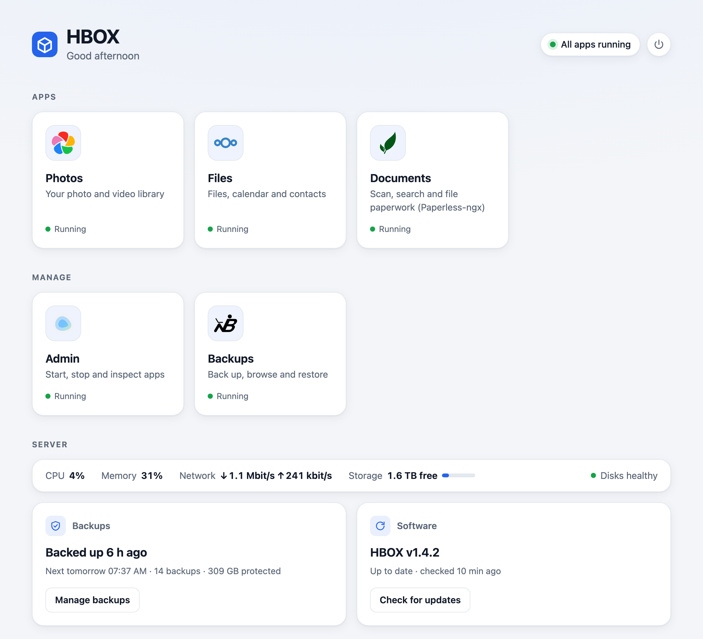
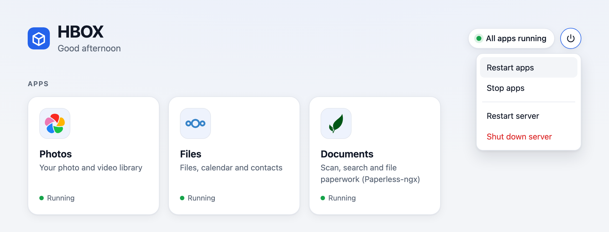
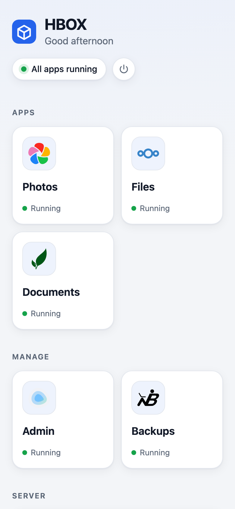
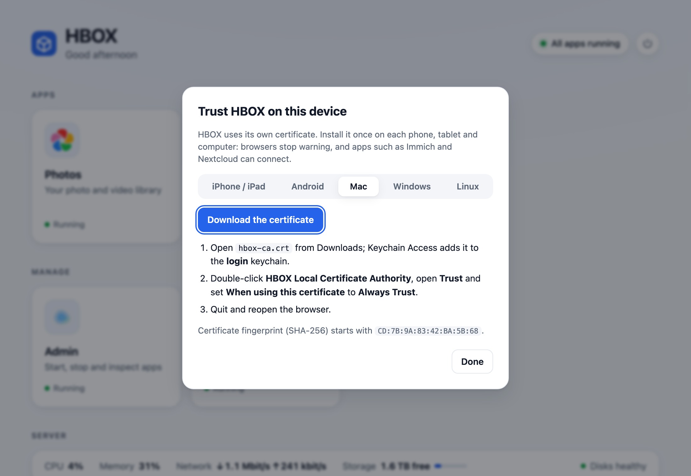

# HBOX

A private home server on Ubuntu or Debian: photos, files, backups and remote
access, installed with one command and updated from git.

<picture>
  <source media="(prefers-color-scheme: dark)" srcset="docs/screenshots/dashboard-dark.png">
  
</picture>

<table>
  <tr>
    <td width="62%"></td>
    <td rowspan="2"></td>
  </tr>
  <tr>
    <td></td>
  </tr>
</table>

<sub>The dashboard (follows the system's light or dark mode), the power menu, <i>Trust this device</i>, and the dashboard on a phone. Screenshots use sample data.</sub>

| App | Address | Software |
| --- | --- | --- |
| Dashboard | `https://hbox.local` | Status and links |
| Photos | `:2443` · `photos.hbox.local` | [Immich](https://immich.app) |
| Files | `:3443` · `files.hbox.local` | [Nextcloud](https://nextcloud.com) |
| Admin | `:5443` · `admin.hbox.local` | [Dockge](https://github.com/louislam/dockge) |
| Backups | `:6443` | [Backrest](https://github.com/garethgeorge/backrest) + [restic](https://restic.net) |
| Remote access | optional | [Tailscale](https://tailscale.com) |
| Documents | optional, `:7443` | [Paperless-ngx](https://docs.paperless-ngx.com) |
| Status | optional, `:4443` | [Uptime Kuma](https://github.com/louislam/uptime-kuma) |

Ports work on any address of the server: `hbox.local`, LAN IP or Tailscale
name. Optional apps: `sudo hbox apps enable paperless` (or `status`).

## Install

Ubuntu 22.04+ or Debian 12+ (amd64/arm64), 4 GB RAM:

```sh
curl -fsSL https://raw.githubusercontent.com/ishrakr/hbox/main/install.sh | sudo bash
```

Then:

1. **Backups:** attach a disk and run `sudo hbox backup disk`. Save the
   printed password off the server.
2. **HTTPS:** trust HBOX's certificate on each device: `sudo hbox ca`.

## Use

```sh
sudo hbox status          # apps, addresses, storage, backups
sudo hbox doctor          # find and fix problems
sudo hbox update          # back up, then update
sudo hbox credentials     # administrator login
hbox help                 # all commands
```

## Documentation

See the [wiki](https://github.com/ishrakr/hbox/wiki) (also in [`wiki/`](wiki/Home.md)):
[installation](wiki/Installation.md), [backups](wiki/Backups.md),
[restore](wiki/Restore.md), [updates](wiki/Updates.md),
[remote access](wiki/Remote-access.md),
[troubleshooting](wiki/Troubleshooting.md).
What changed in each release: [CHANGELOG.md](CHANGELOG.md).

## License

HBOX is licensed under the [GNU General Public License, version 2](LICENSE)
(GPL-2.0-only). The apps it installs (Immich, Nextcloud, Dockge, Backrest,
restic, Tailscale) keep their own licenses.
